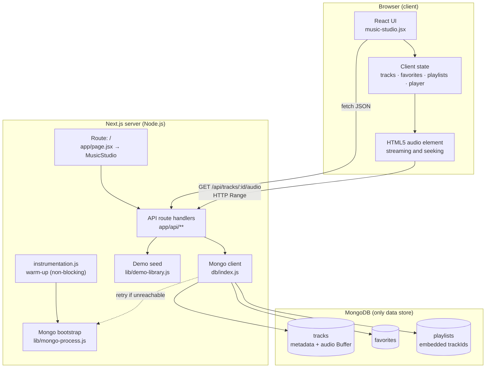
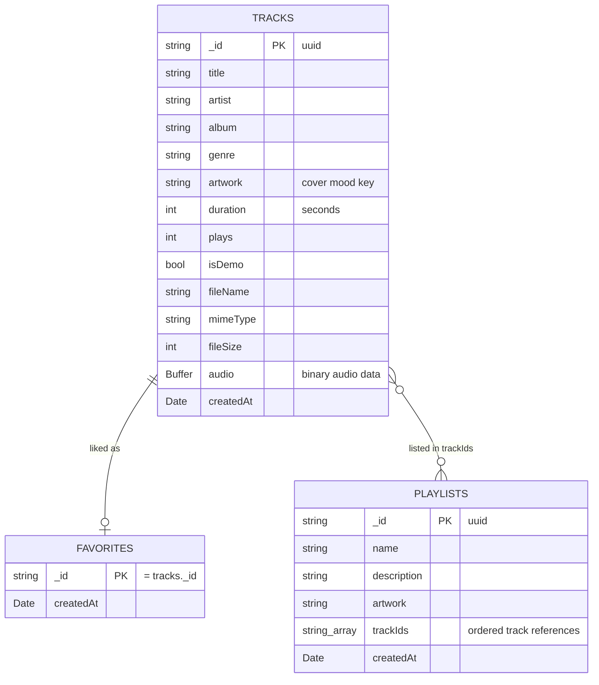
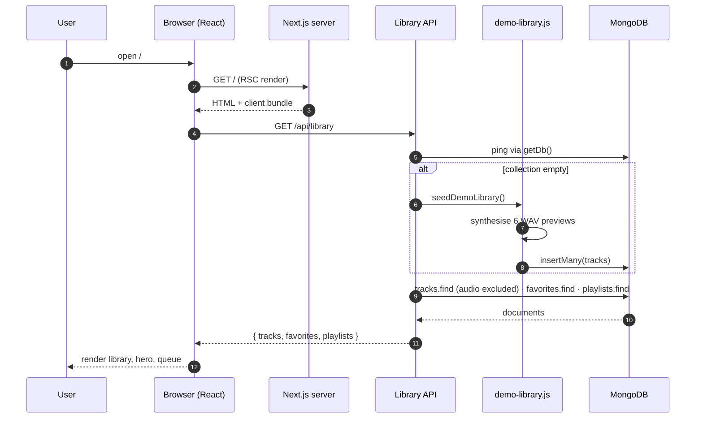
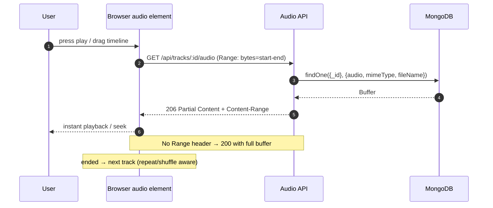
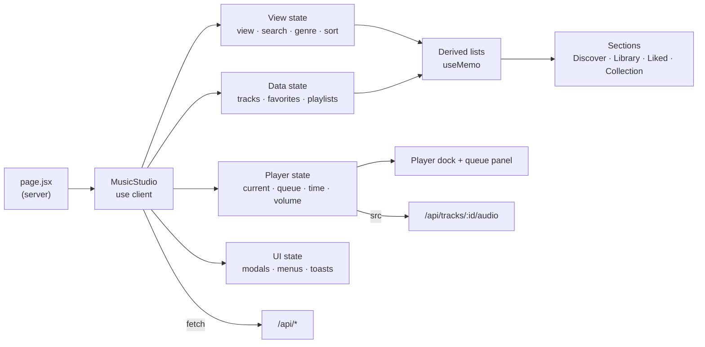
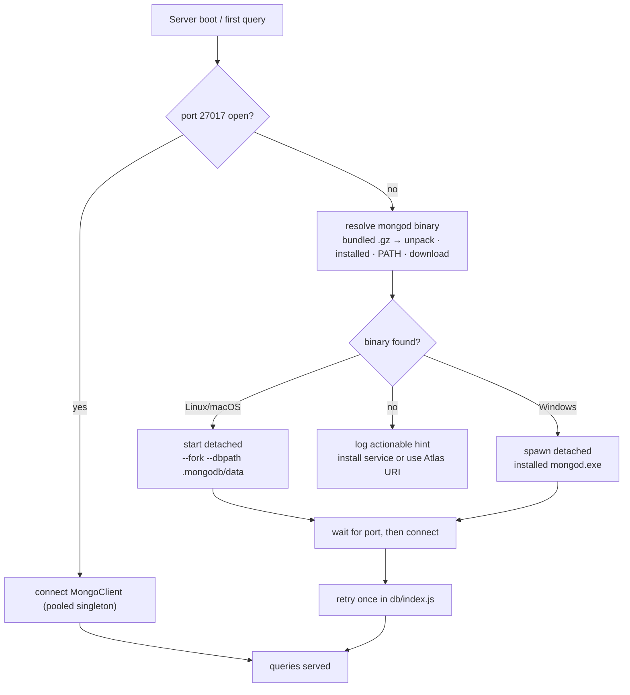

# Architecture

**stillroom** is a single-service, full-stack music app: a Next.js (App Router) application written in plain JavaScript, with React on the client and Node.js route handlers on the server. **MongoDB is the only data store** — metadata *and* the audio files themselves live in MongoDB documents.

---

## 1. High-level system architecture



**Key properties**

| Property | Decision |
| --- | --- |
| Language | Plain JavaScript (`.js` / `.jsx`) — no TypeScript sources |
| Frontend | React 19 via Next.js App Router, one client component (`MusicStudio`) |
| Backend | Next.js Node.js route handlers (REST over `fetch`) |
| Database | MongoDB only (official `mongodb` driver, no ORM) |
| Audio storage | Binary `Buffer` inside the `tracks` document |
| Styling | Tailwind CSS v4 entry + hand-written CSS in `globals.css` |
| Auth | Single-user "listening room" — no accounts, no sessions |

---

## 2. Repository layout

```
src/
├── app/
│   ├── layout.jsx            # root layout + metadata
│   ├── page.jsx              # server entry → renders MusicStudio
│   ├── music-studio.jsx      # "use client" — whole UI + player + state
│   ├── globals.css           # design system, layouts, animations
│   └── api/
│       ├── health/route.js               # GET   MongoDB ping
│       ├── library/route.js              # GET   tracks + favorites + playlists
│       ├── tracks/route.js               # GET   list · POST upload (multipart)
│       ├── tracks/[id]/route.js          # DELETE uploaded track
│       ├── tracks/[id]/audio/route.js    # GET   stream audio (Range → 206)
│       ├── tracks/[id]/play/route.js     # POST  play counter ($inc)
│       ├── favorites/route.js            # GET   liked track ids
│       ├── favorites/[id]/route.js       # PUT / DELETE like
│       ├── playlists/route.js            # GET / POST collections
│       ├── playlists/[id]/route.js       # PATCH / DELETE collection
│       └── playlists/[id]/tracks/route.js# POST / DELETE membership
├── db/
│   └── index.js              # singleton MongoClient + typed collection helpers
├── lib/
│   ├── demo-library.js       # synthesises 6 original WAV previews on first run
│   └── mongo-process.js      # locate/start mongod, survive cold sandboxes
└── instrumentation.js        # background MongoDB warm-up at server boot
```

---

## 3. Data model

Two collections are relational-style (`_id` join), one embeds its members for cheap ordered reads.



**Notes**

- `tracks.audio` holds the raw file bytes; every other query uses a projection (`{ audio: 0 }`) so audio never crosses the wire as JSON.
- `favorites` uses the track id as its own `_id`, making likes idempotent (`upsert`).
- `playlists.trackIds` keeps insertion order and allows atomic `$addToSet` / `$pull`.
- Deleting a track is restricted to uploads (`isDemo: false`); favorites/playlist entries for that id simply no longer resolve.

---

## 4. Request lifecycle

### 4.1 First page load (read path)



### 4.2 Audio streaming (read path, seekable)



---

## 5. API surface

| Method | Route | Purpose | Collection touched |
| --- | --- | --- | --- |
| `GET` | `/api/health` | Health probe / DB ping | — |
| `GET` | `/api/library` | One-shot hydration payload | tracks, favorites, playlists |
| `GET` | `/api/tracks` | Track list (no audio) | tracks |
| `POST` | `/api/tracks` | Multipart upload ≤ 32 MB | tracks |
| `DELETE` | `/api/tracks/:id` | Delete own upload | tracks |
| `GET` | `/api/tracks/:id/audio` | Stream bytes, Range aware | tracks |
| `POST` | `/api/tracks/:id/play` | `$inc` play counter | tracks |
| `GET` | `/api/favorites` | Liked ids | favorites |
| `PUT` / `DELETE` | `/api/favorites/:id` | Like / unlike (idempotent) | favorites |
| `GET` / `POST` | `/api/playlists` | List / create collections | playlists |
| `PATCH` / `DELETE` | `/api/playlists/:id` | Rename / delete | playlists |
| `POST` / `DELETE` | `/api/playlists/:id/tracks` | Add / remove member | playlists |

Errors are JSON `{ "error": "human readable message" }` with `400` (validation), `403` (demo track delete), `404` (missing), `413` (file too large), `415` (unsupported audio), `500` (unexpected).

---

## 6. Client architecture



Single source of truth in one client component keeps cross-feature actions (e.g. "add to collection" from a track row) instant. Lists are derived with `useMemo`; mutations use optimistic UI with rollback on failure.

---

## 7. MongoDB availability strategy

The hosted sandbox can cold-start with no database process. Two layers keep it working:



- `instrumentation.js` warms MongoDB **in the background**, so the web server never blocks on it.
- A `mongodb+srv://` (Atlas) URI is detected as remote — no local start is attempted.

---

## 8. Security & limits

- Uploads validated by MIME type **and** extension; capped at **32 MB**; metadata fields trimmed and length-limited.
- `audio` is always excluded from JSON projections (never leaks into API payloads).
- Audio responses are `Cache-Control: private` and inline-disposition with an encoded filename.
- All database access is parameterised by the driver — no string-built queries.
- No secrets in the client bundle: only `MONGODB_URL` (server-side, git-ignored) is read.

---

## 9. Deliberate trade-offs

| Choice | Why | Cost |
| --- | --- | --- |
| Audio in MongoDB | One data store, zero external services | 16 MB doc limit → upload cap, no CDN caching |
| Single client component | Fast cross-feature state, fewer files | large file; would split by context at scale |
| Embedded `trackIds` | Ordered membership, atomic add/remove | denormalised; no join metadata per entry |
| Generated demo tracks | Works instantly on a fresh clone | ~1.8 MB seeded on first visit |
| No auth | Personal listening room | not multi-tenant; would need sessions + user scoping |

**Next steps if this grew:** GridFS or object storage for large audio, indexes on `tracks.createdAt`, `tracks.title`, auth + per-user collections, and paginated library queries.
